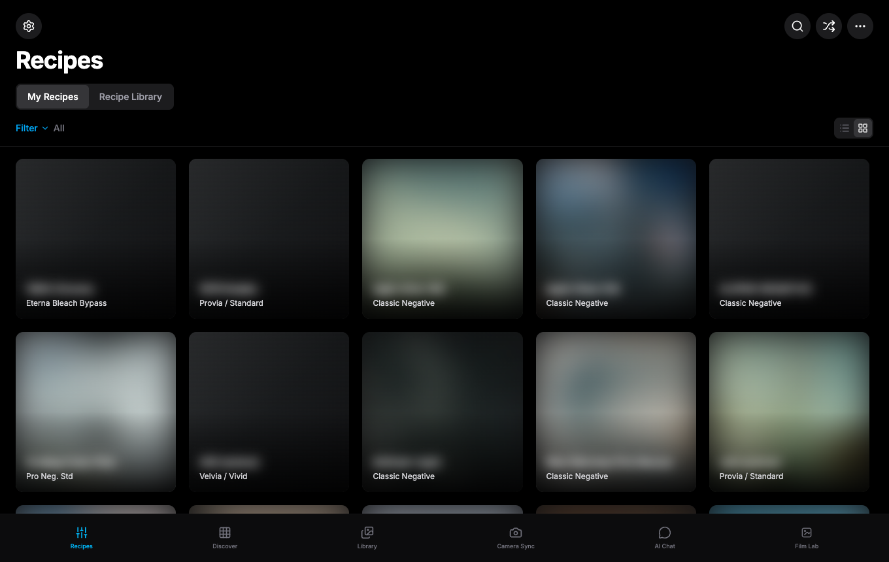
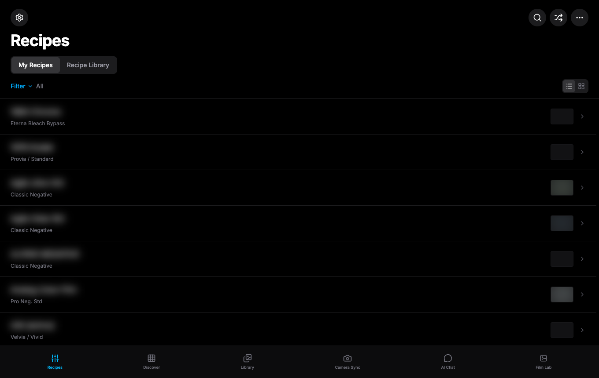
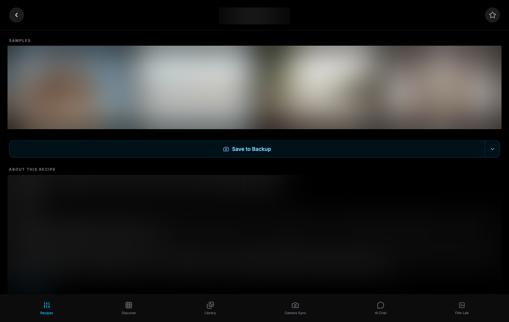
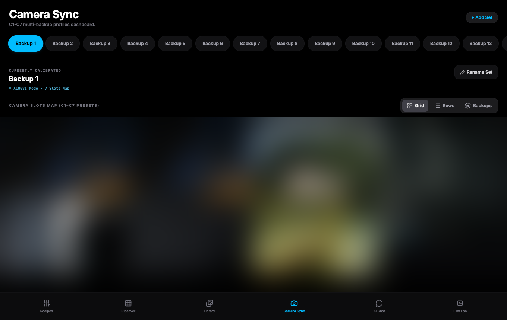
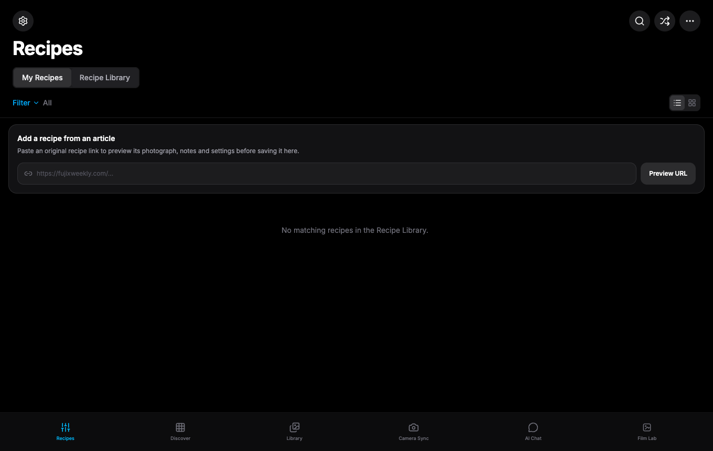
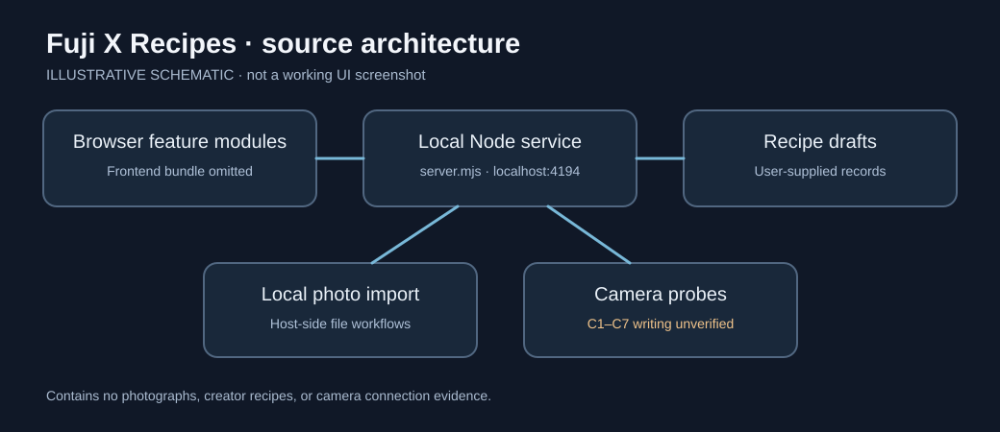

# Fuji X Recipes — source and camera-workflow preview

## Interface screenshots

These are **authentic captures of the installed Fuji X Recipes interface**, served by the running local FujiX Sync service on November 14, 2026. They were captured through the app’s exact configured local URL using a separate headless Chrome window. Recipe names, creator excerpts and image content have been blurred where necessary; the visible layouts, modes and controls come from the real app. The captures do not prove a camera connection or physical camera writes.

| Recipe photo grid | Recipe list |
| --- | --- |
|  |  |

| Recipe detail | Camera Sync |
| --- | --- |
|  |  |

See [image provenance and redactions](docs/screenshots/README.md) and [source architecture](docs/ARCHITECTURE.md).

The screenshots document **installed interface behavior**, while the included repo contains the separate publishable source subset. The historical React frontend is present locally only as compiled JavaScript and CSS, and has not been added to this release. Consequently this checkout cannot reproduce the pictured full interface from source alone. The architecture diagram is an illustration, not a screenshot.

This repository publishes the original local FujiX Sync **Node.js backend source**, camera photo import and recipe backup workflows, handwritten web modules, unit tests and the macOS launcher bootstrap source. It contains no photographer's library or creator-supplied recipe collection. Start with `node server.mjs` (Node 20+ recommended); the backend listens on 127.0.0.1:4194.

**Release limitation:** The installed Fuji X Recipes app is a Tauri/WebKit launcher to the local FujiX Sync service. Its historical React frontend was only available as compiled assets in this workspace, and those assets are deliberately omitted from this source release. The provided HTML entry still refers to that unavailable build. The complete installed desktop UI is therefore **not reproducible from this repository alone**. The standalone native Tauri shell is also not bundled; `native-launcher/fuji_launcher.c` is a bootstrap reference and requires a separately built workspace-shell. Do not advertise this checkout as a complete packaged app.

The previous collection of 101 creator-derived recipes, their original PDF, images, external photo references, enriched metadata and user backups are withheld pending redistribution review. `web/recipes.json` has an empty schema-compatible placeholder; supply legally redistributable data locally. The local recipe backup/restore API works with user-supplied records and does not program camera slots. Photos stay local.

**Physical hardware status:** A user previously reported successful Web Bluetooth shutter operation through Chrome; this does not prove USB camera profile writes. Physical Fujifilm X100VI C1–C7 writing, restore and readback are **NOT proven**; UI slots represent locally staged assignments. Other USB/PTP and Wi-Fi paths have varying proof levels and must be validated with a real X100VI. Do not treat a simulation or a capability response as successful camera transfer. No camera access was performed in preparing this repository.

Validation: run `node --test tests/*.test.mjs` for the source-only subset. Some original integration assertions require the withheld frontend, 101-recipes fixture or hardware, and may fail; inspect those failures rather than reporting them as camera successes.

Licensing: The original FujiX Sync integration code has no verified public license grant. Distribution and reuse rights have to be confirmed with the owner; included third-party license notices appear in `licenses/`. GitHub visibility, even in a public repository, does **not** itself grant reuse rights. Review authorship and dependency notices before distributing this source.

## Supported camera-side manual workflow

The Fujifilm X100VI officially offers **USB RAW CONV./BACKUP RESTORE** for use with the supported **FUJIFILM X Acquire** utility. Before changing settings, use X Acquire to back up the actual camera configuration and verify your backup. Then enter the desired settings using the X100VI's own image-quality menu and save the desired custom bank using the camera controls. The public FujiX app stores separate local recipe drafts for reference, but does **not** install those drafts into camera C1–C7. The official full-settings backup format has not been reverse-engineered or validated for synthesizing individual recipes.

Official references: [X100VI Network/USB menu](https://app.fujifilm-dsc.com/en/manual/x100vi/connections/network_usb_menu/), [Fujifilm X Acquire compatibility](https://www.fujifilm-x.com/en-us/support/compatibility/software/x-acquire/), and [X100VI image-quality settings](https://app.fujifilm-dsc.com/en/manual/x100vi/menu_shooting/image_quality_setting/).
