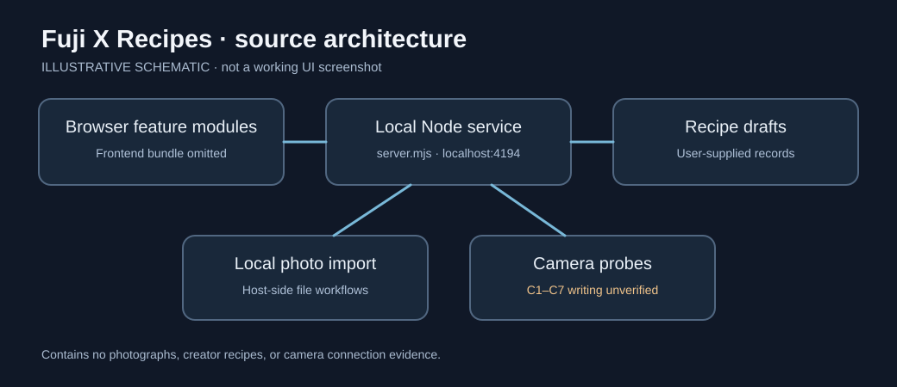

# Architecture and capability guide

This document describes the **included source**, not a reproducible full desktop release. The missing compiled React frontend and Tauri shell are described in [README](../README.md).

## Included components

| Layer | Files | What it does |
| --- | --- | --- |
| Local service | `server.mjs` | Binds the localhost service and routes camera, library, and recipe requests. |
| Recipe management | `recipe-hub-store.mjs`, `recipe-backup-restore.mjs`, `recipe-hub-intake.mjs` | Stores, imports, and backs up user-provided records. |
| Photo and import workflows | `camera-card-import.mjs`, `usb-ptp-selected-import.mjs`, `local-photo-library.mjs` | Provides host-side workflows and guarded import paths. |
| Camera research and transport | `direct-camera-transfer.mjs`, `usb-ptp-*.mjs`, `tools/x100vi-*` | Contains transport probes and read-oriented capability tools. Their presence does not prove camera preset programming. |
| Handwritten browser modules | `web/*.mjs`, `web/*.css` | Feature-specific UI source that historically integrated with a separate compiled frontend. |
| Platform helpers | `*.swift`, `native-launcher/` | macOS-specific connectivity helpers and bootstrap source; a standalone desktop app cannot be built from these alone. |
| Tests | `tests/*.test.mjs` | Node test coverage; some suites depend on omitted original fixtures or runtime integrations. |

## User data and examples

The historical collection of 101 third-party creator recipes is omitted. `web/recipes.json` is an empty placeholder. To test recipe functionality, supply records you created or have permission to redistribute. Original photos, camera dumps, credentials, settings, samples, and caches are outside this publication candidate.

## Camera-specific verification boundary

The local C1–C7 assignments are drafts. **X100VI physical custom-bank write, backup restoration and subsequent readback have not been demonstrated.** Do not assume a successful HTTP response, preview, Bluetooth shutter command, or USB detection implies the camera accepted a setting. Use Fujifilm's official X Acquire full-settings backup/restore application for actual camera backups, and the camera's controls for manual C-bank configuration.

## Running and development

Node.js 20 or newer is recommended. From the repository root run `node server.mjs`, then inspect the localhost service on port 4194. The browser `web/index.html` references assets that are absent from this release and is **not** a self-contained frontend. The server may require local dependencies or host features for individual routes. For contained validation, run `node --test tests/<selected-file>.test.mjs` or the full source set `node --test tests/*.test.mjs`, documenting fixture-specific failures.

This source needs an owner-approved license before public publication. See [ATTRIBUTION.md](../ATTRIBUTION.md) and retained third-party notices under `licenses/`.
